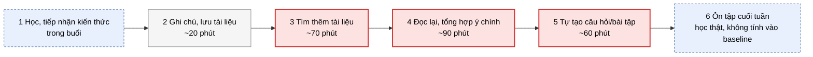
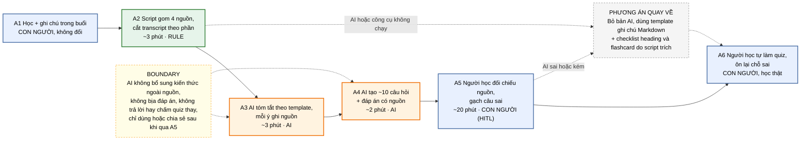

# Báo cáo nhóm — Day 02 Discovery & Problem Framing

> Bản chung của nhóm, viết trên repo do nhóm trưởng fork. Không copy file này sang repo cá nhân.
> Template chi tiết và prompt mẫu: [docs/01-worksheet.md](../../docs/01-worksheet.md). Bài mẫu: [docs/02-deliverable-example.md](../../docs/02-deliverable-example.md).

## 1. Thông tin nhóm

- Tên nhóm: NhomHTHT
- Thành viên: xem `TEAM.md`
- Candidate problem được chọn (1 câu): Tổng hợp kiến thức và tạo tài liệu ôn tập sau buổi học
- Quyết định cuối: Go / Not Yet / No-Go

---

## 2. Hội tụ nhóm (CP3)

### 2.1. Pitch

| # | Người đưa ra | Candidate (Job Story ngắn) | Actor | Bottleneck | Câu hỏi phản biện nhận được (ai hỏi) |
|---:|---|---|---|---|---|
| 1 | Võ Huy Hoàng | Kiểm tra bài Lab với Requirement và Rubric | Student | Phải đọc nhiều tài liệu và đối chiếu thủ công giữa bài làm, Requirement và Rubric | **1.** AI chấm sai thì ai chịu trách nhiệm? Với những requirement và rubric chung chung thì liệu AI có hiểu nhầm không? (Hoàng Anh) **2.** Công sức bỏ ra có đáng không? Khóa này còn vài tuần là hết. Nếu build giải pháp của card bạn thì mất bao lâu? Build xong còn bao nhiêu buổi lab để dùng? Thời gian tiết kiệm được (phút/lần × số lần còn lại × số người dùng) có nhiều hơn thời gian build + sửa lỗi không? So với làm checklist (gần như không tốn thời gian build) thì sao? (Trung Anh) |
| 2 | Võ Huy Hoàng | Tổng hợp kiến thức và tạo tài liệu ôn tập sau buổi học | Student | Phải tự tìm kiếm, đọc và tổng hợp thông tin từ nhiều nguồn, sau đó tự xây dựng nội dung ôn tập | **1.** Công sức bỏ ra có đáng không? Khóa này còn vài tuần là hết. Nếu build giải pháp của card bạn thì mất bao lâu? Build xong còn bao nhiêu buổi lab để dùng? Thời gian tiết kiệm được (phút/lần × số lần còn lại × số người dùng) có nhiều hơn thời gian build + sửa lỗi không? So với làm checklist (gần như không tốn thời gian build) thì sao? (Trung Anh) |
| 3 | Võ Huy Hoàng | Điền file AI-Logs.md | Student, LabCoach | Phải nhớ lại các tương tác AI trước đó, chọn lọc thông tin quan trọng và trình bày lại theo đúng cấu trúc Markdown | **1.** Log tự điền thì có đáng tin không? Lấy lịch sử dùng AI từ đâu (mỗi công cụ một kiểu)? (Hoàng Anh) **2.** Công sức bỏ ra có đáng không? Khóa này còn vài tuần là hết. Nếu build giải pháp của card bạn thì mất bao lâu? Build xong còn bao nhiêu buổi lab để dùng? Thời gian tiết kiệm được (phút/lần × số lần còn lại × số người dùng) có nhiều hơn thời gian build + sửa lỗi không? So với làm checklist (gần như không tốn thời gian build) thì sao? (Trung Anh) |
| 4 | Nguyễn Hoàng Anh | Đọc hiểu yêu cầu đề bài lab | Học viên (cá nhân và trưởng nhóm) | Phải đọc đi đọc lại, tra thuật ngữ khi gặp khái niệm lạ | **1.** Nếu sử dụng AI để giải thích đề bài, làm sao đảm bảo AI không diễn giải sai yêu cầu gốc? (Huy Hoàng) **2.** Đề bài lab thường có nhiều ràng buộc ngầm và tiêu chí chấm điểm rất chi tiết (như SUBMISSION, RUBRIC). Nếu để AI tóm tắt, làm sao bạn chắc chắn AI không tóm tắt thiếu các quy định nhỏ khiến cả nhóm bị trừ điểm oan? (Ngọc Tuyên) **3.** Việc đọc lâu là do đề bài khó hay do mình thiếu checklist đọc nhanh? Nếu chỉ cần 1 bảng câu hỏi cố định (Nộp file gì? Deadline lúc nào? Tiêu chí nào nhiều điểm nhất?) thì có cần đến AI không? (Ngọc Tuyên) **4.** Công sức bỏ ra có đáng không? Khóa này còn vài tuần là hết. Nếu build giải pháp của card bạn thì mất bao lâu? Build xong còn bao nhiêu buổi lab để dùng? Thời gian tiết kiệm được (phút/lần × số lần còn lại × số người dùng) có nhiều hơn thời gian build + sửa lỗi không? So với làm checklist (gần như không tốn thời gian build) thì sao? (Trung Anh) |
| 5 | Nguyễn Hoàng Anh | Phân chia công việc cho thành viên nhóm | Trưởng nhóm | Thường có tranh luận hoặc không ai tự nguyện nhận phần khó | **1.** AI sẽ xử lý thế nào nếu phần việc không phù hợp với thành viên được giao/thành viên không đủ khả năng handle task đấy? (Huy Hoàng) **2.** Làm sao đảm bảo công việc được phân chia đồng đều và không có thành viên bị quá tải? (Huy Hoàng) **3.** Nút thắt làm mất 45 phút thực chất là lúc 'nghĩ ra đầu việc', hay là lúc 'thương lượng ai nhận phần khó'? AI có giải quyết được tâm lý đùn đẩy phần khó của thành viên không? (Ngọc Tuyên) **4.** AI không biết được tuần này ai bận thi, ai giỏi phần nào và thời gian rảnh của từng người. Liệu AI phân chia có thực tế hơn việc 4 người bật mic nói chuyện 5 phút không? (Ngọc Tuyên) **5.** Công sức bỏ ra có đáng không? Khóa này còn vài tuần là hết. Nếu build giải pháp của card bạn thì mất bao lâu? Build xong còn bao nhiêu buổi lab để dùng? Thời gian tiết kiệm được (phút/lần × số lần còn lại × số người dùng) có nhiều hơn thời gian build + sửa lỗi không? So với làm checklist (gần như không tốn thời gian build) thì sao? (Trung Anh) |
| 6 | Nguyễn Hoàng Anh | Kiểm tra tiến độ commit của thành viên theo branch | Trưởng nhóm | Phải lặp lại cho từng thành viên | **1.** Nỗi đau ở đây là do 'GitHub khó theo dõi', hay do 'thành viên không chịu commit đúng hạn'? Nếu thành viên không chịu làm bài thì dù có tool báo cáo tự động, bạn vẫn phải đi nhắn tin giục từng người bằng tay? (Ngọc Tuyên) **2.** GitHub đã có sẵn tab Network Graph, và chỉ cần 1 Webhook/GitHub Action bắn thông báo về Discord/Telegram mỗi khi có commit mới là xong. Việc này chỉ cần Rule cơ bản, tại sao lại cần đến AI ở đây? (Ngọc Tuyên) 3. Công sức bỏ ra có đáng không? Khóa này còn vài tuần là hết. Nếu build giải pháp của card bạn thì mất bao lâu? Build xong còn bao nhiêu buổi lab để dùng? Thời gian tiết kiệm được (phút/lần × số lần còn lại × số người dùng) có nhiều hơn thời gian build + sửa lỗi không? So với làm checklist (gần như không tốn thời gian build) thì sao? (Trung Anh) |
| 7 | Nguyễn Trung Anh | Đặt xe và canh app chờ tài xế nhận | Quản lý kế hoạch sản xuất ở xưởng gia công nhỏ, người duy nhất lo cả sản xuất lẫn giao hàng | Canh app chờ tài xế nhận; thực tế quản lý canh app suốt từ lúc đặt đến lúc giao thành công, đơn nào cũng vậy | **1.** Vấn đề nằm ở việc thiếu tài xế, thời gian chờ hay việc phải liên tục theo dõi ứng dụng? (Huy Hoàng) |
| 8 | Nguyễn Trung Anh | Theo dõi hàng trên đường, lo giao trễ | Quản lý kế hoạch sản xuất; khách nhận hàng | Mở app xem và gọi tài xế, đơn nào cũng phải làm; nặng hơn với đơn sau 17h | **1.** Nếu AI cảnh báo sai rằng đơn hàng sẽ giao trễ, điều đó có gây ảnh hưởng đến kế hoạch sản xuất hoặc khách hàng không? (Huy Hoàng) |
| 9 | Nguyễn Trung Anh | Đặt xe máy cho rẻ nhưng không ai nhận, phải trả thêm hoặc đổi xe | Quản lý kế hoạch sản xuất; xưởng nằm ở khu ít đơn nên tài xế xe máy tụ ở chỗ khác | Chờ không ai nhận rồi phải trả thêm hoặc đổi xe | |
| 10 | Dương Ngọc Tuyên | Đối chiếu quy cách bài lab trước khi nộp | Sinh viên đang làm bài lab môn học | Mở file báo cáo và rà soát checklist chuyển qua lại giữa nhiều file tài liệu, rất dễ nhìn sót | **1.** Công sức bỏ ra có đáng không? Khóa này còn vài tuần là hết. Nếu build giải pháp của card bạn thì mất bao lâu? Build xong còn bao nhiêu buổi lab để dùng? Thời gian tiết kiệm được (phút/lần × số lần còn lại × số người dùng) có nhiều hơn thời gian build + sửa lỗi không? So với làm checklist (gần như không tốn thời gian build) thì sao? (Trung Anh) |
| 11 | Dương Ngọc Tuyên | Báo cáo tiến độ tuần cho nhóm đồ án | Thành viên phụ trách tổng hợp báo cáo tuần của nhóm đồ án | Soạn phần nhận định và phân tích rủi ro mất nhiều thời gian vì phải tổng hợp dữ liệu rời rạc và diễn đạt thành câu chữ rõ ràng. | **1.** Làm sao đảm bảo AI không bỏ sót công việc hoặc báo cáo sai tiến độ của thành viên? (Huy Hoàng) **2.** Công sức bỏ ra có đáng không? Khóa này còn vài tuần là hết. Nếu build giải pháp của card bạn thì mất bao lâu? Build xong còn bao nhiêu buổi lab để dùng? Thời gian tiết kiệm được (phút/lần × số lần còn lại × số người dùng) có nhiều hơn thời gian build + sửa lỗi không? So với làm checklist (gần như không tốn thời gian build) thì sao? (Trung Anh) |
| 12 | Dương Ngọc Tuyên | Dò tìm bài tập mẫu trong video bài giảng | Sinh viên tự học, tự ôn tập bài tập lớn | Dò tìm mốc thời gian bài tập mẫu trong video dài không có timestamp | **1.** Nếu video không có transcript hoặc nội dung được trình bày bằng hình ảnh/code, giải pháp có tìm kiếm chính xác được không? (Huy Hoàng) **2.** Công sức bỏ ra có đáng không? Khóa này còn vài tuần là hết. Nếu build giải pháp của card bạn thì mất bao lâu? Build xong còn bao nhiêu buổi lab để dùng? Thời gian tiết kiệm được (phút/lần × số lần còn lại × số người dùng) có nhiều hơn thời gian build + sửa lỗi không? So với làm checklist (gần như không tốn thời gian build) thì sao? (Trung Anh) |

### 2.2. Cluster

| Cluster | Các candidate | Pattern chung |
|---|---|---|
| A — Báo cáo / tổng hợp |  Tổng hợp kiến thức và tạo tài liệu ôn tập, Điền file AI-Logs.md, Đọc hiểu yêu cầu đề bài lab, Báo cáo tiến độ tuần | Gom và tổng hợp thông tin viết báo cáo |
| B — Tìm kiếm | Đặt xe và canh app chờ tài xế nhận, Theo dõi hàng trên đường, Đặt xe máy cho rẻ nhưng không ai nhận | Tìm đúng thông tin |
| C — Review | Kiểm tra bài Lab với Requirement và Rubric, Đối chiếu quy cách bài lab | Đọc source, so sánh và chỉ ra sai sót |
| D — Theo dõi việc | Phân chia công việc, Kiểm tra tiến độ commit, Dò tìm bài tập mẫu | Tổng hợp thông tin từ Git |

### 2.3. Opportunity Solution Tree rút gọn

Gốc là **1 outcome**. Nhánh là **opportunity** (nhu cầu, pain), không phải tính năng hay công cụ.

```text
Outcome: Giảm thời gian mỗi thành viên mất cho việc gom, tìm, kiểm và theo dõi thông tin lặp lại mỗi tuần, để dành thời gian cho phần việc chính

 ├── Opportunity A (cluster A): Mất nhiều thời gian gom thông tin từ nhiều nguồn
 │                              rồi viết lại thành báo cáo cho người khác đọc
 │
 ├── Opportunity B (cluster B): Khó tìm đúng thông tin (quyết định cũ, tài liệu, câu trả lời)
 │                              vì nó nằm rải rác ở nhiều nơi
 │
 ├── Opportunity C (cluster C): Bản nháp có thiếu sót mà người viết không tự thấy,
 │                              người review phải đọc kỹ mới chỉ ra được
 │
 └── Opportunity D (cluster D): Sau cuộc họp, nhiều việc cần làm bị quên hoặc rơi mất
                                vì không ai theo dõi đến cùng
```

Những ý đã gạch bỏ vì là solution đội lốt opportunity:
```text
.Bot tóm tắt họp / tự động viết báo cáo tuần (cluster A): Pain thật là “mất thời gian gom và viết lại”.

.Chatbot hỏi đáp FAQ lab / tìm kiếm thông minh trên Slack, LMS (cluster B): Pain thật là “thông tin rải rác, khó tìm”.

.AI review PRD / tự chấm Problem Statement (cluster C): Pain thật là “thiếu sót không tự phát hiện được”.

.Nhắc deadline tự động / dashboard theo dõi action item (cluster D): Pain thật là “việc bị rơi sau họp”.
```

### 2.4. Chấm điểm shortlist (1–5)

| Candidate | Actor rõ | Quy trình rõ | Pain có bằng chứng | Impact đo được | Vừa sức lab | So sánh được No AI/Rule/Workflow/Agent | Nhóm hiểu domain | Tổng |
|---|---:|---:|---:|---:|---:|---:|---:|---:|
| Kiểm tra bài Lab với Requirement và Rubric | 5 | 3 | 3 | 5 | 4 | 4 | 3 | **27** |
| Tổng hợp kiến thức và tạo tài liệu ôn tập sau buổi học | 5 | 4 | 5 | 4 | 4 | 5 | 5 | **32** |
| Đọc hiểu yêu cầu đề bài lab | 5 | 4 | 4 | 4 | 4 | 3 | 5 | **29** |
| Đặt xe máy cho rẻ nhưng không ai nhận, phải trả thêm hoặc đổi xe | 5 | 4 | 5 | 3 | 2 | 2 | 3 | **24** |
| Đặt xe và canh app chờ tài xế nhận | 5 | 4 | 5 | 3 | 2 | 2 | 3 | **24** |

**Candidate được chọn:**
**Tự động tổng hợp kiến thức và tạo tài liệu ôn tập sau buổi học** (Candidate #2 của Võ Huy Hoàng).

**Vì sao chọn:**
1. **Đạt điểm cao nhất (32 điểm)** trên bảng đánh giá 7 tiêu chí khách quan của cả nhóm.
2. **Nhu cầu có thật, tần suất lặp lại cao:** Diễn ra sau mỗi buổi học trong suốt kỳ học (không chỉ giới hạn ở các buổi lab), ảnh hưởng đến toàn bộ sinh viên.
3. **Domain quen thuộc 100%:** Cả 4 thành viên đều là sinh viên, trực tiếp trải qua nỗi đau ngợp tài liệu và thiếu công cụ ôn tập phản xạ, dễ dàng phỏng vấn và kiểm chứng ngay tại lớp.
4. **Baseline đo lường rõ ràng:** Hiện tại sinh viên mất 3–4 tiếng đọc lại tài liệu để ôn tập; target giảm xuống dưới 45 phút mà vẫn nắm được 85%+ khái niệm cốt lõi.
5. **Rất rõ nét khi so sánh 4 mức can thiệp:** No AI (dùng template Cornell Note/Notion), Rule (script tách text và outline từ slide), Workflow (AI trích xuất khái niệm và tạo quiz), Agent (tự tìm tài liệu mở rộng và chấm điểm tự luận).

**Vì sao loại các candidate còn lại:**
- *Tự động kiểm tra bài Lab với Requirement và Rubric (27 điểm):* Cấu trúc bài lab và rubric thay đổi liên tục theo từng buổi, AI khó nắm bắt được tiêu chí chấm linh hoạt của LabCoach, nguy cơ rủi ro cao nếu AI chấm sai.
- *Đọc hiểu yêu cầu đề bài lab (29 điểm):* Chỉ diễn ra ở đầu buổi học, khó đo lường chính xác ranh giới giữa việc "hiểu đúng đề" với "đọc tóm tắt qua loa".
- *Các bài toán đặt xe xưởng sản xuất (24 điểm):* Không khả thi để kiểm chứng trong thời gian 4 tiếng của buổi lab; không thể can thiệp vào hệ thống và thuật toán điều xe của bên thứ ba (Grab/Ahamove).

**Xử lý bất đồng (nếu có):**
Ban đầu có sự phân vân giữa đề tài kiểm tra bài lab và tổng hợp tài liệu ôn tập. Sau khi chấm điểm chi tiết, nhóm nhận thấy đề tài tài liệu ôn tập có impact rộng hơn, thị trường đã có nhiều công cụ mẫu (NotebookLM, Quizlet) để research học hỏi kiến trúc, và dễ phỏng vấn người thật trong lớp hơn. Cả nhóm đồng thuận 100% chọn candidate này.

---

## 3. Kiểm chứng + research giải pháp đã có (CP4)

### 3.1. Assumption Map

| # | Giả định | Loại (Value / Usability / Feasibility / Viability) | Quan trọng (1–5) | Đã có bằng chứng (1–5) | Kiểm chứng trước? |
|---:|---|---|---:|---:|---|
| 1 | Sinh viên sau buổi học thực sự muốn ôn lại kiến thức bằng tóm tắt và câu hỏi trắc nghiệm/flashcard thay vì chỉ đọc lại slide. | Value | 5 | 2 | ✅ |
| 2 | Bước tốn thời gian nhất là đọc lại toàn bộ slide/recording để lọc ý chính và tự soạn câu hỏi, không phải việc học thuộc. | Value | 5 | 2 | ✅ |
| 3 | Người học tin tưởng và sẵn sàng dùng câu hỏi/tóm tắt do AI tạo ra nếu có dẫn nguồn (citation) rõ ràng về trang slide gốc. | Usability / Value | 4 | 2 | ✅ |
| 4 | Slide bài giảng (PDF) và transcript đủ cấu trúc để mô hình AI trích xuất đúng khái niệm cốt lõi mà không bịa đặt (hallucination). | Feasibility | 4 | 3 | — |
| 5 | Nhà trường / giảng viên cho phép đưa tài liệu bài giảng nội bộ vào các công cụ AI để xử lý. | Viability | 4 | 2 | Kiểm tra sau lab |

Giả định nhóm kiểm chứng trong buổi này: **Giả định #1, #2 và #3** (thuộc nhóm quan trọng cao nhưng ít bằng chứng thực tế).

### 3.2. Kiểm chứng

Cách đã dùng: Phỏng vấn trực tiếp 3 sinh viên ở nhóm khác (theo nguyên tắc **The Mom Test**: chỉ hỏi về hành vi đã xảy ra trong quá khứ, không hỏi giả định tương lai) kết hợp làm micro poll 8 bạn trong lớp.

**Interview snapshot 1:**

| Trường | Nội dung |
|---|---|
| Người được hỏi (vai trò, không ghi tên thật) | Sinh viên năm 3 ngành Khoa học dữ liệu / AI |
| Câu nói đáng nhớ nhất (nguyên văn) | *"Mỗi lần học xong 2 tiếng trên lớp về là mình cất luôn slide, bảo cuối tuần đọc lại nhưng đến tận tuần thi mới lôi ra đọc trong hoảng loạn."* |
| Lần gần nhất gặp vấn đề này: chuyện gì đã xảy ra? | Tuần trước, chuẩn bị kiểm tra giữa kỳ môn Machine Learning, mở 6 bộ slide hơn 250 trang đọc trong 2 đêm, không kịp làm bài tập thực hành. |
| Hiện đang xử lý bằng cách nào (workaround)? | Mượn vở tóm tắt của bạn học chăm nhất hoặc lên mạng search đề thi trắc nghiệm các khóa trước. |
| Mất bao lâu, bao lần? | 4–5 tiếng trước mỗi kỳ thi; ngày thường = 0 phút (do lười và ngại đọc lại file dài). |
| Insight / opportunity rút ra | Sinh viên không thiếu tài liệu, sinh viên thiếu một công cụ "đóng gói kiến thức" nhỏ gọn ngay sau buổi học để giảm rào cản tâm lý khi bắt đầu ôn tập. |

**Interview snapshot 2:**

| Trường | Nội dung |
|---|---|
| Người được hỏi (vai trò, không ghi tên thật) | Sinh viên năm 2 ngành Kỹ thuật phần mềm |
| Câu nói đáng nhớ nhất (nguyên văn) | *"Nếu tài liệu tóm tắt mà không chỉ rõ trang nào trong slide thì mình không dám tin, vì sợ AI tự chế công thức."* |
| Lần gần nhất gặp vấn đề này: chuyện gì đã xảy ra? | Đọc slide môn Xác suất thống kê, thử paste vào ChatGPT để tóm tắt nhưng ChatGPT giải thích sai ký hiệu toán học so với quy ước của thầy trên lớp. |
| Hiện đang xử lý bằng cách nào (workaround)? | Tự gõ ghi chú vào Notion, chụp màn hình công thức từ slide dán vào. |
| Mất bao lâu, bao lần? | Mất 60–90 phút cho mỗi bài giảng nếu chăm chỉ làm; thường bỏ cuộc sau 2–3 tuần đầu. |
| Insight / opportunity rút ra | Tính năng dẫn nguồn (Citation) trực tiếp về trang slide gốc là điều kiện tiên quyết để người học tin tưởng và sử dụng. |

**Interview snapshot 3:**

| Trường | Nội dung |
|---|---|
| Người được hỏi (vai trò, không ghi tên thật) | Học viên lớp AI thực chiến (lớp khác cùng khóa) |
| Câu nói đáng nhớ nhất (nguyên văn) | *"Mình chỉ cần bộ 5–10 câu hỏi trắc nghiệm test nhanh sau mỗi bài xem mình hổng chỗ nào, không cần bài văn tóm tắt dài dòng."* |
| Lần gần nhất gặp vấn đề này: chuyện gì đã xảy ra? | Tối qua, học xong buổi lab, muốn biết mình có nắm được bản chất của bài học không nhưng không có bộ câu hỏi tự kiểm tra. |
| Hiện đang xử lý bằng cách nào (workaround)? | Nhắn tin hỏi bạn cùng nhóm xem có hiểu giống mình không, trao đổi qua Discord. |
| Mất bao lâu, bao lần? | 25–30 phút trao đổi qua lại nhưng không có đáp án chuẩn. |
| Insight / opportunity rút ra | Đầu ra giá trị nhất không phải là bài tóm tắt dài (summary text), mà là bộ câu hỏi tự kiểm tra phản xạ (Active Recall Quiz) kèm giải thích đúng/sai. |

Tổng hợp:

| Nguồn | Số người / số mẫu | Tín hiệu xác nhận | Tín hiệu phản bác |
|---|---:|---|---|
| Phỏng vấn sâu (The Mom Test) | 3 | 3/3 đều thừa nhận ngại đọc lại slide dài và thường dồn đến trước thi; 2/3 muốn có câu hỏi trắc nghiệm/flashcard ôn nhanh ngay sau buổi học. | 1 bạn nói thích tự viết tay flashcard vì tự viết mới nhớ được, tóm tắt của AI đọc xong cũng nhanh quên; 1 bạn chỉ tin tài liệu nếu có trích dẫn đúng trang slide của giảng viên. |
| Micro poll trong lớp | 8 | 6/8 cho biết mất trên 2 tiếng mỗi tuần nếu muốn tự tổng hợp tài liệu học; 7/8 muốn có quiz tự kiểm tra sau buổi học. | 2/8 nói họ chỉ cần xem lại code mẫu thực hành trên GitHub chứ không quan tâm đến lý thuyết bài giảng. |

**Nhóm đã sửa problem thế nào sau kiểm chứng:**
1. **Thu hẹp phạm vi đầu ra (Scoping down):** Từ mục tiêu ban đầu là *"Tự động tạo toàn bộ tài liệu học tập tổng hợp thay thế việc đọc slide"* thu hẹp thành *"Trích xuất 5–7 khái niệm cốt lõi và tự động sinh 5–10 câu hỏi trắc nghiệm/flashcard có dẫn nguồn trang slide để người học tự kiểm tra nhanh trong 15 phút sau buổi học"*.
2. **Bổ sung yêu cầu bắt buộc về Citation (Dẫn nguồn):** Mọi câu hỏi và định nghĩa tóm tắt đều phải trỏ đúng số trang slide hoặc đoạn ghi chú gốc để người học tự đối chiếu khi nghi ngờ, giải quyết triệt để rủi ro mất niềm tin vào AI.
3. **Tôn trọng phương án No AI:** Bổ sung phương án dùng template câu hỏi ôn tập (Cornell Notes) cho những sinh viên thích tự ghi chép để ghi nhớ sâu.

### 3.3. Research giải pháp đã có

| Công cụ / case / pattern | Link | Giải bước nào trong quy trình? | Điểm mạnh | Khoảng trống / rủi ro | Bài học cho nhóm |
|---|---|---|---|---|---|
| **Google NotebookLM** | https://notebooklm.google.com/ | Bước 2–4: Tải slide PDF lên, AI tự động tóm tắt, tạo Study Guide, FAQ và Audio Overview | Độ chính xác cao, bám sát tài liệu nguồn (grounded in source), luôn kèm trích dẫn số trang (citation) | Không có tính năng tạo bộ câu hỏi trắc nghiệm tương tác lặp lại ngắt quãng (Spaced Repetition), không xuất được sang Anki/Quizlet | **Học hỏi cơ chế trích dẫn nguồn (grounding)**: Không để AI tự do chém gió, mà bắt buộc phải trích nguồn từ tài liệu gốc. |
| **Quizlet Magic Notes / Q-Chat** | https://quizlet.com/features/magic-notes | Bước 3–5: Upload tài liệu/note, tự động tạo flashcards, câu hỏi trắc nghiệm và chế độ kiểm tra | Có sẵn hệ sinh thái luyện tập phản xạ (Flashcard, Spaced repetition, Quiz game) | Bản miễn phí bị giới hạn lượt dùng; tóm tắt các tài liệu kỹ thuật/code toán còn nông và hay nhầm công thức; phải trả phí gói Plus | **Học hỏi định dạng đầu ra**: Đầu ra tốt nhất cho ôn tập là Flashcard (thuật ngữ - giải thích) và Quiz trắc nghiệm 4 lựa chọn, thay vì văn bản dài. |
| **Otter.ai** | https://otter.ai/ | Bước 1–2: Ghi âm, chuyển giọng nói thành văn bản (transcript) và tạo tóm tắt cuộc họp/bài giảng | Xử lý file âm thanh/video bài giảng tốt, tự phân tách người nói và trích xuất bullet points | Chỉ dừng lại ở việc tóm tắt nội dung hội thoại, không có tư duy sư phạm (không tạo câu hỏi trắc nghiệm, không đánh giá độ hiểu bài) | **Nhận định ranh giới**: Không nên cố xử lý file âm thanh thô (nặng, tốn tài nguyên), mà nên bắt đầu từ tài liệu dạng chữ (slide PDF, export transcript) để tối ưu chi phí và độ chính xác. |

**Kết luận research:**
Thị trường đã có nhiều sản phẩm giải quyết từng mảnh ghép: NotebookLM làm rất tốt khâu tóm tắt có trích dẫn từ PDF, Quizlet làm rất tốt khâu tạo thẻ ôn tập. Vì vậy, **nhóm không cần và không nên tự xây dựng một mô hình AI từ đầu**. Thay vào đó, kiến trúc hợp lý nhất là một **Workflow**:
`Tài liệu buổi học (Slide PDF / Note) → AI trích xuất key concepts & sinh Quiz kèm trích dẫn nguồn → Sinh viên làm bài test & xem lại trang slide tương ứng`.

---

## 4. Quy trình trước/sau (CP5)

### 4.1. Quy trình hiện tại

Sơ đồ (ASCII, Mermaid hoặc link ảnh trong `report/assets/`):

```text
HIỆN TẠI — 6 bước, ~240' chuẩn bị ôn tập mỗi buổi

[1 Học, tiếp nhận kiến thức: trong buổi]
→ [2 Ghi chú, lưu tài liệu: ~20']
→ [3 Tìm thêm tài liệu: ~70']          ← BOTTLENECK
→ [4 Đọc lại, tổng hợp ý chính: ~90']  ← BOTTLENECK
→ [5 Tự tạo câu hỏi/bài tập: ~60']     ← BOTTLENECK
→ [6 Ôn tập cuối tuần: học thật, không tính vào baseline]

```

```markdown

```

| Bước | Actor | Input | Output | Thời gian / tần suất | Ghi chú |
|---:|---|---|---|---|---|
| 1 | Learner | Bài giảng của giảng viên | Kiến thức tiếp nhận trên lớp | Trong buổi học, mỗi buổi | Không tính vào baseline |
| 2 | Learner | Slide, tài liệu `docs/*.md`, transcript | Ghi chú cá nhân, tài liệu đã lưu | ~20' (ước lượng), mỗi buổi | Thủ công |
| 3 | Learner | Phần chưa hiểu từ bước 2 | Danh sách tài liệu bổ sung | ~70' (ước lượng), mỗi buổi | **Nghẽn**: tự tìm trên nhiều nguồn |
| 4 | Learner | Ghi chú + tài liệu gốc + tài liệu bổ sung | Bản tổng hợp ý chính | ~90' (ước lượng), mỗi buổi | **Nghẽn**: dễ bỏ sót ý, không biết mình yếu phần nào |
| 5 | Learner | Bản tổng hợp | Câu hỏi/bài tập tự kiểm tra | ~60' (ước lượng), mỗi buổi | **Nghẽn**: tự đặt câu hỏi và tự biết đáp án |
| 6 | Learner | Bản tổng hợp + bộ câu hỏi | Kiến thức được ôn lại | Cuối tuần | Là việc học thật, ngoài baseline |

**Bottleneck chính:**
Bước 3–5, khoảng 220/240 phút (~92%). Người học phải tự tìm, đọc, tổng hợp từ nhiều nguồn rồi tự đặt câu hỏi cho chính mình.

### 4.2. Quy trình tương lai

Ghi rõ bước nào **Rule**, bước nào **AI**, bước nào **con người**, **boundary** ở đâu, **phương án quay về** khi AI sai.

```text
TƯƠNG LAI — khoảng 28' chuẩn bị/buổi (chưa tính bước làm quiz thật)

[A1 Học + ghi chú trong buổi]                             ← CON NGƯỜI (không đổi)
→ [A2 Script gom 4 nguồn, cắt transcript theo phần: ~3'] ← RULE
→ [A3 AI tóm tắt theo template, mỗi ý ghi nguồn: ~3']    ← AI
→ [A4 AI tạo ~10 câu hỏi + đáp án có nguồn: ~2']         ← AI
→ [A5 Người học đối chiếu nguồn, gạch câu sai: ~20']     ← CON NGƯỜI (HITL)
→ [A6 Người học tự làm quiz, ôn lại chỗ sai]             ← CON NGƯỜI (học thật)

BOUNDARY:
- AI không tự bổ sung kiến thức ngoài tài liệu nguồn; ý ngoài nguồn phải đánh dấu "ngoài tài liệu".
- AI không tạo công thức, ví dụ, đáp án không có căn cứ.
- AI không trả lời quiz thay và không chấm người học.
- Bản AI chỉ được dùng hoặc chia sẻ cho nhóm sau khi qua bước A5.

PHƯƠNG ÁN QUAY VỀ:
- Bản tóm tắt/câu hỏi sai hoặc kém → người học bỏ bản AI, dùng template ghi chú Markdown
  + checklist heading và flashcard từ bảng "Thuật ngữ" do script (Rule) trích.
- AI hoặc công cụ không chạy → bước A2 vẫn cho ra checklist, người học tự làm từ đó.

```

```markdown

```

### 4.3. Before / after

| Chỉ số | Trước | Sau (kỳ vọng) | Ghi chú |
|---|---:|---:|---|
| Số bước | 6 | 6 | Gộp bước 1+2; thêm bước script, tóm tắt, tạo câu hỏi, kiểm tra. Số bước không giảm, thay đổi nằm ở ai làm bước nào. |
| Tổng thời gian | ~240' | ~28' | Target ở mục 5: dưới 30'. Chưa tính tìm thêm tài liệu và làm quiz. Là kỳ vọng, chưa đo. |
| Số bước thủ công | 6/6 | 3/6 | A1, A5, A6 do người học; A2 là Rule; A3, A4 là AI. |
| Bottleneck chính | Bước 3–5 (tìm, tổng hợp, tự đặt câu hỏi) | Bước A5 (kiểm tra đối chiếu nguồn) | Chấp nhận được vì đây là điểm kiểm soát chất lượng, giống bài mẫu. |
| Rủi ro mới phát sinh | — | AI bịa hoặc tóm tắt hời hợt; người học chỉ đọc tóm tắt rồi bỏ qua bước tự học; transcript dài bị cắt mất ngữ cảnh; người học tin bản AI nên kiểm qua loa. | Xử lý bằng boundary (bắt buộc trích nguồn, đánh dấu “ngoài tài liệu”) và tiêu chí đánh giá ở mục 7. |

---

## 5. Problem Statement v0 (CP5)

| Trường | Nội dung |
|---|---|
| **Actor** | Learner |
| **Quy trình** | 1. Tham gia buổi học và tiếp nhận kiến thức từ giảng viên. 2. Ghi chú hoặc lưu lại các tài liệu được cung cấp. 3. Sau buổi học, tìm kiếm thêm tài liệu để hiểu rõ những nội dung chưa nắm vững. 4. Đọc lại tài liệu và tổng hợp các kiến thức quan trọng. 5. Tự tạo câu hỏi hoặc bài tập để kiểm tra mức độ hiểu bài. 6. Ôn tập lại kiến thức vào cuối tuần. |
| **Bottleneck** | Bước 3–5: Phải tự tìm kiếm, đọc và tổng hợp thông tin từ nhiều nguồn, sau đó tự xây dựng nội dung ôn tập. |
| **Impact** | Tốn nhiều thời gian cho việc tìm kiếm và tổng hợp thay vì tập trung vào thực hành. Kiến thức có thể bị quên nếu không được ôn tập thường xuyên. Người học cũng có thể bỏ sót những nội dung quan trọng hoặc không biết mình đang yếu ở phần kiến thức nào. |
| **Success Metric** | Thời gian tổng hợp và chuẩn bị tài liệu ôn tập: 4 giờ → dưới 30 phút. Tự động tạo bản tóm tắt kiến thức và bộ câu hỏi sau mỗi buổi học. Nội dung được tạo phải bám sát tài liệu gốc, hướng tới độ chính xác trên 90% qua kiểm tra thủ công. |
| **Boundary** | **AI không được:** 1. Tự ý bổ sung kiến thức không có trong tài liệu nguồn mà không đánh dấu rõ ràng. 2. Tạo thông tin, công thức, ví dụ hoặc đáp án không có căn cứ. **Con người cần kiểm tra (HITL):** 1. Đối chiếu bản tóm tắt với tài liệu gốc để phát hiện thông tin sai lệch hoặc bị bỏ sót. 2. Kiểm tra tính chính xác và mức độ phù hợp của câu hỏi, bài tập và đáp án được tạo ra. |

Phản biện nhận được (từ AI hoặc nhóm khác) và nhóm có đồng ý không:

- Nhóm đồng ý

---

## 6. Mức can thiệp AI (CP6)

### 6.1. Ma trận độ mơ hồ × độ phức tạp

Bài của nhóm nằm ở ô: **Độ mơ hồ cao × Độ phức tạp thấp–trung bình** → Workflow có AI ở một bước là đủ.

Vì sao:
- **Mơ hồ cao:** một buổi học có nhiều cách tóm tắt và nhiều bộ câu hỏi ôn tập đều chấp nhận được, không có một đáp án đúng duy nhất.
- **Phức tạp không cao dù có 4 nguồn** (tài liệu, slide, transcript, ghi chú cá nhân):
  - Cả 4 nguồn **đều có sẵn sau mỗi buổi** và được đưa vào cùng lúc. AI không phải tự đi tìm, không phải quyết định đọc nguồn nào trước.
  - Phần AI chỉ gồm 2 bước định sẵn (tóm tắt → tạo câu hỏi). Các bước còn lại là script hoặc do người học làm.
- **Nếu cho AI tự tìm thêm tài liệu trên Internet** (bước 3 trong card gốc) thì nguồn không còn cố định, và bước sau phụ thuộc kết quả tìm kiếm. Khi đó bài toán chuyển hẳn sang ô phức tạp cao. Nhóm chọn **không** giao bước này cho AI.

### 6.2. So sánh 4 mức

| Mức | Phương án cho bài của nhóm | Đủ khi nào | Rủi ro | Chọn? |
|---|---|---|---|---|
| **No AI** (sửa quy trình) | Template ghi chú Markdown cố định sau mỗi buổi; mỗi thành viên tóm tắt 1 phần rồi chia sẻ cho nhóm; tự làm flashcard | Tài liệu ít; nhóm đều đặn chia việc và làm đúng hạn; người học thích tự viết để nhớ (1/3 người phỏng vấn ở CP4) | Vẫn tốn nhiều thời gian (baseline ~4 giờ); chất lượng không đều giữa các người | Không làm mặc định; giữ template ghi chú (Cornell Notes) cho người thích tự viết |
| **Rule** | Script gom 4 nguồn của buổi học (tài liệu `docs/*.md`, slide, transcript, ghi chú) vào 1 chỗ; trích heading thành checklist ôn tập; biến bảng "Thuật ngữ" có sẵn thành flashcard | Tài liệu có cấu trúc rõ (heading, bảng thuật ngữ) | Chỉ nhặt được chữ có sẵn; không tóm được ý; không tạo được câu hỏi kiểm tra hiểu | Một phần: dùng cho bước gom tài liệu |
| **Workflow** | (1) Script gom 4 nguồn của buổi học (dạng chữ) → (2) AI trích 5–7 khái niệm cốt lõi theo template cố định, mỗi ý ghi nguồn → (3) AI tạo 5–10 câu quiz/flashcard kèm đáp án, trích trang slide hoặc mục tài liệu → (4) người học xem lại, gạch câu sai → (5) người học tự làm quiz | Nguồn là 4 loại tài liệu có sẵn của buổi học và đưa được hết cho AI | AI bịa nội dung; tóm tắt hời hợt | **Chọn** |
| **Agent** | AI tự tìm thêm tài liệu trên mạng, tự đoán người học yếu phần nào, tự lặp tạo bài ôn đến khi "đủ" | Cần cá nhân hóa sâu và có dữ liệu kết quả học của từng người | Nguồn không kiểm soát được; khó chấm đầu ra; chi phí cao; quá sức với khóa học chỉ còn vài tuần | Không |

**Mức chọn:** Workflow (bước gom tài liệu dùng Rule; bước tóm tắt và tạo câu hỏi dùng AI; bước kiểm tra và tự làm quiz do người học).

**Vì sao không chọn mức đơn giản hơn:**
- **Rule** chỉ trích được chữ có sẵn trong tài liệu. Nó không tạo được bản tóm tắt ý chính hay câu hỏi kiểm tra hiểu, mà đây chính là bước nghẽn của quy trình hiện tại (đọc, tổng hợp, tự đặt câu hỏi).
- **No AI** là cách đang làm, mất khoảng 4 giờ mỗi buổi.
- **Không chọn Agent** vì các bước đã biết trước và cố định, không cần AI tự quyết bước tiếp theo. Agent chỉ thêm rủi ro về nguồn và chi phí.
- **Không cần tự build:** research CP4 (mục 3.3) cho thấy công cụ có sẵn đã làm được từng phần:
  - NotebookLM tóm tắt bám tài liệu và có trích số trang, nhưng không có quiz ôn lặp lại.
  - Quizlet tạo được flashcard và quiz, nhưng bản miễn phí bị giới hạn lượt và hay nhầm với nội dung kỹ thuật.
  - Otter.ai chỉ làm transcript, không tạo câu hỏi.

  Vì vậy Workflow của nhóm là ghép các bước này bằng một prompt template cố định, không tự xây mô hình. Bắt đầu từ tài liệu dạng chữ (slide PDF, transcript đã xuất), không xử lý file âm thanh thô.

### 6.3. AI Canvas rút gọn

| Thành phần | Nội dung |
|---|---|
| **Prediction** — AI dự đoán / tạo ra gì? | 5–7 khái niệm cốt lõi của buổi học và 5–10 câu quiz/flashcard kèm đáp án; mỗi ý, mỗi đáp án có trích nguồn (số trang slide hoặc tên file + mục). Không làm bản tóm tắt dài, vì CP4 cho thấy người học cần câu hỏi tự kiểm tra hơn là văn bản tóm tắt |
| **Judgment** — con người cân nhắc, quyết định gì? | Người học quyết định câu nào sai hoặc thừa, phần nào phải đọc lại tài liệu gốc |
| **Action** — hành động cuối cùng là gì, ai làm? | Người học tự trả lời quiz và ôn lại phần trả lời sai. AI không trả lời thay, không chấm người học |
| **Outcome** — đo kết quả bằng gì? | Thời gian chuẩn bị ôn tập (~4 giờ → dưới 30 phút); % ý có trích nguồn đúng; số câu người học phải gạch mỗi buổi |
| **Input** — AI cần dữ liệu đầu vào gì mỗi lần chạy? Có sẵn không? | 4 nguồn, **đều có sẵn** sau mỗi buổi: tài liệu `docs/*.md` trong repo lab, slide, transcript buổi học, ghi chú cá nhân của người học. Transcript dài (~2 giờ) có thể phải cắt theo từng phần trước khi đưa cho AI |
| **Feedback** — lấy phản hồi ở đâu để cải thiện? | Câu bị người học gạch (sai/thừa) dùng để sửa prompt template; so sánh câu hỏi AI tạo với câu coach thường hỏi khi chấm |

### 6.4. Hai câu hỏi của Google PAIR

- Người dùng muốn **được hỗ trợ (augment)** hay **giao hẳn việc (automate)**? → **Augment.** Bằng chứng từ CP4 (mục 3.2, 3 người phỏng vấn + poll 8 người):
  - 7/8 người trong poll muốn có quiz để tự kiểm tra sau buổi học.
  - Một người nói chỉ cần 5–10 câu trắc nghiệm để biết mình hổng chỗ nào, không cần bài tóm tắt dài.
  - Một người thích tự viết flashcard vì tự viết mới nhớ, đọc tóm tắt của AI xong là quên.

  Người học muốn AI làm phần nặng (gom, lọc ý, soạn câu hỏi), còn tự trả lời câu hỏi vẫn là việc của họ, vì đó là lúc học thật. Nếu AI làm hết và người học chỉ đọc bản tóm tắt thì nhanh hơn nhưng nhớ kém hơn.
- AI sai kiểu nào tệ hơn, **báo nhầm** hay **bỏ sót**? Vì sao, và thiết kế đã xử lý thế nào:
  **Nội dung sai hoặc bịa tệ hơn bỏ sót.** Người học sẽ tin và học sai. Còn nếu AI bỏ sót một khái niệm, tài liệu gốc vẫn còn để đọc. CP4 xác nhận điều này: một người phỏng vấn từng nhờ ChatGPT tóm tắt slide và bị giải thích sai ký hiệu toán so với quy ước của thầy, nên không dám tin bản tóm tắt nếu không chỉ rõ trang slide. Thiết kế xử lý như sau:
  - mọi ý tóm tắt và đáp án đều bắt buộc trích nguồn;
  - ý nào không có trong tài liệu thì đánh dấu "ngoài tài liệu";
  - người học kiểm tra trước khi dùng hoặc chia sẻ cho nhóm.

---

## 7. Problem Statement v1 + tiêu chí đánh giá (CP6)

| Trường | Nội dung |
|---|---|
| **Actor** | Mọi học viên lớp AI thực chiến ở lớp khác cùng khóa |
| **Quy trình** | 1. Tham gia buổi học và tiếp nhận kiến thức từ giảng viên. 2. Ghi chú hoặc lưu lại các tài liệu được cung cấp. 3. Sau buổi học, tìm kiếm thêm tài liệu để hiểu rõ những nội dung chưa nắm vững. 4. Đọc lại tài liệu và tổng hợp các kiến thức quan trọng. 5. Tự tạo câu hỏi hoặc bài tập để kiểm tra mức độ hiểu bài. 6. Ôn tập lại kiến thức vào cuối tuần. |
| **Bottleneck** | Bước 3–5: Phải tự tìm kiếm, đọc và tổng hợp thông tin từ nhiều nguồn, sau đó tự xây dựng nội dung ôn tập. Kết quả CP4: 3/3 người được phỏng vấn ngại đọc lại slide dài và dồn tới sát kỳ thi mới ôn; người học cần câu hỏi tự kiểm tra hơn là bản tóm tắt. |
| **Impact** | Tốn nhiều thời gian cho việc tìm kiếm và tổng hợp thay vì tập trung vào thực hành. Kiến thức có thể bị quên nếu không được ôn tập thường xuyên. Người học cũng có thể bỏ sót những nội dung quan trọng hoặc không biết mình đang yếu ở phần kiến thức nào. Số liệu CP4: 6/8 người trong poll mất trên 2 tiếng/tuần nếu tự tổng hợp tài liệu; 1 người mất 4–5 tiếng trước mỗi kỳ thi (ngày thường 0 phút); 1 người mất 60–90 phút/bài nếu chăm làm và thường bỏ cuộc sau 2–3 tuần. |
| **Success Metric** (baseline → target, cách đo) | Thời gian tổng hợp và chuẩn bị tài liệu ôn tập: 4 giờ → dưới 30 phút. Tự động tạo bản tóm tắt kiến thức và bộ câu hỏi sau mỗi buổi học. Nội dung được tạo phải bám sát tài liệu gốc, hướng tới độ chính xác trên 90%, đo bằng cách đọc lướt để confirm bản tóm tắt. |
| **Boundary** | **AI không được:** 1. Thêm kiến thức ngoài tài liệu. 2. Tạo thông tin, công thức, ví dụ hoặc đáp án không có căn cứ. **Con người kiểm tra:** AI có một bản mục lục để người dùng tự đọc lướt confirm. |
| **AI intervention point** | Bước 4 (đọc lại, tổng hợp kiến thức) và bước 5 (tạo câu hỏi). Bước 3 (tìm thêm tài liệu) không giao cho AI. |
| **Mức chọn** | Workflow |
| **Rủi ro & người kiểm tra** | **Rủi ro:** AI bịa nội dung, tóm tắt hời hợt; lúc đọc thấy chỗ cấn thì người học sẽ tự biết. Đây là bản tổng hợp nên người học đọc tóm tắt là đúng. **Người kiểm tra:** chính người học. |

**Thay đổi so với v0 và lý do:**

| Trường | v0 | v1 | Vì sao đổi |
|---|---|---|---|
| Actor | Learner | Mọi học viên lớp AI thực chiến ở lớp khác cùng khóa | Vì nó được thiết kế cụ thể cho bài học của khóa, lớn hơn không thể kiểm soát được data đầu vào |
| Bottleneck | Bước 3–5, chưa có bằng chứng | Giữ bước 3–5, thêm phát hiện CP4 | Thêm số liệu từ phỏng vấn và poll CP4 |
| Impact | Chưa có số | Thêm số liệu CP4 | Thêm số liệu từ phỏng vấn và poll CP4 |
| Success Metric | Độ chính xác đo qua kiểm tra thủ công | Độ chính xác đo bằng đọc lướt để confirm bản tóm tắt | Tự bấm giờ và cảm nhận, độ chính xác thì đọc lướt |
| Boundary | AI không thêm kiến thức ngoài mà không đánh dấu; người học đối chiếu bản tóm tắt với tài liệu gốc | AI không được thêm kiến thức ngoài tài liệu; AI có bản mục lục để người dùng đọc lướt confirm | Nếu người học phải đối chiếu toàn bộ bản tóm tắt với tài liệu gốc thì mất hết thời gian tiết kiệm được |
| AI intervention point, Mức chọn, Rủi ro & người kiểm tra | Chưa có | Bước 4–5; Workflow; người học tự kiểm tra | Mẫu v1 yêu cầu thêm; lấy từ mục 6 |

**Tiêu chí đánh giá đầu ra của AI (3–5 tiêu chí):**

| # | Tiêu chí | Đạt khi | Không đạt khi |
|---:|---|---|---|
| 1 | Mục lục đầy đủ | Mục lục liệt kê đầy đủ các mục lớn quan trọng (người học tự cảm nhận) | Cần thêm hoặc sửa |
| 2 | Thời gian | Tự bấm giờ dưới 30 phút | Từ 30 phút trở lên |
| 3 | Đủ số câu hỏi | Đủ 5–10 câu hỏi | Ít hơn 5 câu hỏi |

---

## 8. Quyết định (CP6)

### 8.1. Bốn rủi ro

| Rủi ro | Câu hỏi | Mức độ rủi ro (Thấp = an toàn / TB / Cao = nguy hiểm) | Lý do / bằng chứng |
|---|---|---|---|
| **Value** | Người dùng có thật sự cần và sẽ dùng không? | | |
| **Usability** | Người dùng có dùng được, có hiểu và sửa được đầu ra của AI không? | | |
| **Feasibility** | Có đủ dữ liệu, công cụ, kỹ năng để làm không? | | |
| **Viability** | Có hợp chi phí, pháp lý, quy định tổ chức không? Ai vận hành? | | |

### 8.2. Kết luận

**Quyết định:** Go / Not Yet / No-Go

**Lý do:**

**Nếu Go — pilot nhỏ nhất:**

**Nếu Not Yet — cần kiểm chứng gì trước:**

**Nếu No-Go — nên làm gì thay AI:**

**Ngưỡng dừng** (nếu sau … mà … thì quay về …):

---

## 9. Hạn chế và hướng tiếp theo

-

## 10. Tài liệu tham khảo

-
